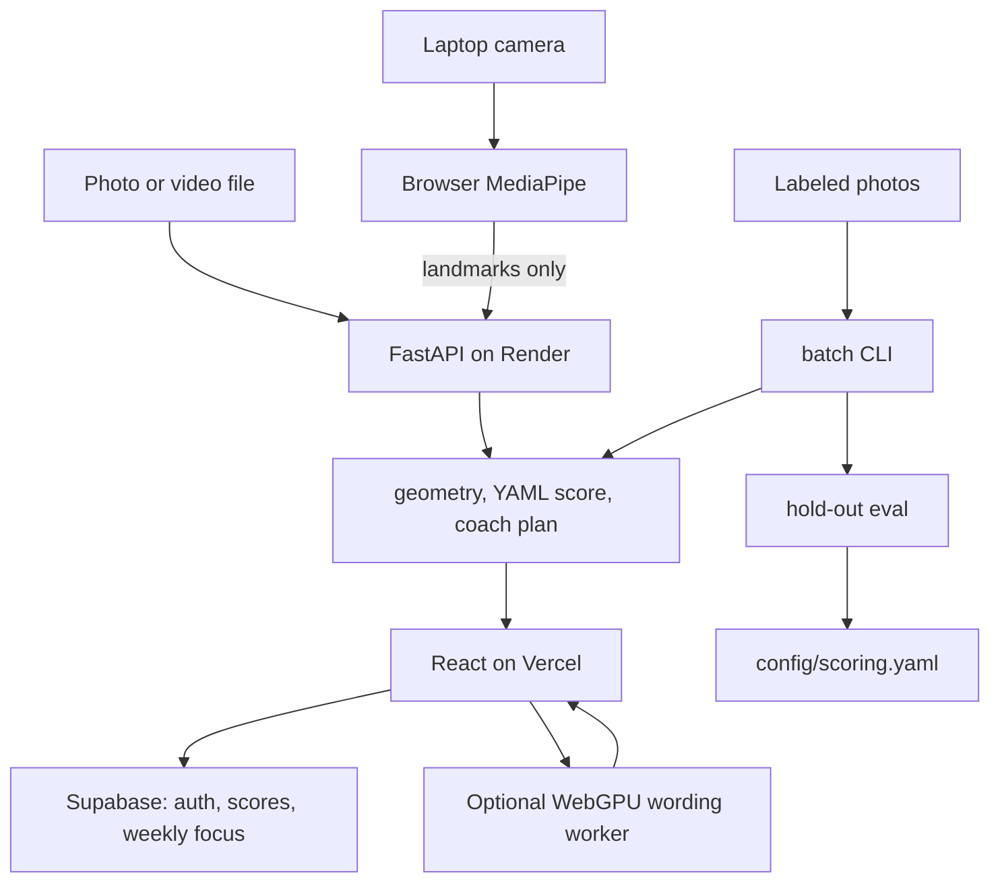

<a id="readme-top"></a>

<br />
<div align="center">
  <a href="https://github.com/defAaron/TechniqueTitan">
    
  </a>

  <h3 align="center">Technique Titan</h3>

  <p align="center">
    A piano posture coach that scores both hands from a laptop camera,
    locks a weekly focus from saved sessions, and can reword a tip on-device.
    <br />
    <a href="https://technique-titan.vercel.app"><strong>Live app</strong></a>
    ·
    <a href="docs/README.md">Doc map</a>
    ·
    <a href="https://github.com/defAaron/TechniqueTitan/blob/main/docs/PRD.md">PRD</a>
  </p>
</div>

Technique Titan turns a photo, a video, or a live camera into five geometry scores per hand and one coaching sentence. Detection is MediaPipe’s 21 landmarks. Scoring is explainable geometry in YAML, not a black-box grade. Wording is a template catalog, with an optional browser language model that is allowed to change the sentence only when a validator agrees with the plan.

The interesting parts of the system, and where to read them:

| Idea | Where it lives |
|---|---|
| Palm-normalized 3D geometry for five posture criteria | [`src/technique_titan/`](src/technique_titan/README.md) |
| Anatomical left/right (MediaPipe’s selfie labels are inverted) | [`detection/`](src/technique_titan/detection/README.md) |
| Piecewise scores, severity bands, weighted composite | [`config/`](config/README.md) |
| Live video stays on the laptop; the server only receives landmarks | [`web/src/lib/`](web/src/lib/README.md) |
| Tips hold still: EMA + 1.2 s dwell, same math in Python and TypeScript | [`coach/`](src/technique_titan/coach/README.md) |
| One weekly focus from 14 days of saved sessions, stored on `/progress` | [`coach/`](src/technique_titan/coach/README.md) |
| Optional Qwen 0.5B wording in a WebGPU worker; templates win on any failure | [`web/src/workers/`](web/src/workers/README.md) |
| Progress stores scores and tips only, sized for Supabase’s free tier | [`progress/`](src/technique_titan/progress/README.md) |
| Offline logistic regression that does not replace YAML until it wins hold-out | [`ml/`](src/technique_titan/ml/README.md) |
| Frozen 10-image hold-out and a train-only threshold notebook | [`eval/`](src/technique_titan/eval/README.md) |

Last measured heuristic hold-out macro accuracy is **0.689** (Cohen’s κ **0.103**) on the frozen real-image split, after the 2026-09-19 YAML promotion. The target in the PRD is ≥ 85%. Production scoring stays on `config/scoring.yaml`.

## What a session does

1. **See the hands.** Photo and video run MediaPipe Hands `0.10.21` on the API. Live practice runs `@mediapipe/tasks-vision` in the browser (GPU, CPU fallback) and posts 21 landmarks per hand to `POST /v1/score/landmarks`. The camera frames stay on the device.
2. **Put the hand in a shared frame.** Landmarks are shifted so the wrist is the origin and scaled so the palm span (index MCP to pinky MCP) is 1. World landmarks are preferred when MediaPipe provides them.
3. **Measure five criteria.** Wrist height, finger curvature, thumb position, wrist lateral deviation, and hand arch. Each hand is scored on its own. If MediaPipe assigns both hands the same side, wrist x-position splits them.
4. **Map metrics to 0–100.** Inside the `ideal` band the score is 100. At the `limit` edges it is 0. The falloff is linear. `≥ 80` is good, `≥ 50` is warning, below that is critical. Weights: wrist 0.25, fingers 0.25, arch 0.20, thumb 0.15, lateral 0.15.
5. **Hold the feedback.** An exponential moving average (`α = 0.35`) smooths the score. Severity and direction change only after they have been pending for **1200 ms**, so a live tip does not flicker every frame.
6. **Pick one sentence.** `CoachPlan` speaks the worst current problem, or a different criterion that has gone critical after the dwell. If the request includes saved-session history, it can instead speak the weekly focus. Copy comes from `config/coaching.yaml`. A cell with four variants picks one with SHA-256 of (optional user id, plan key, UTC date). Photo, video, and the live client currently omit the user id, so that daily pick is shared. `/progress` is what sends history and writes the lock.
7. **Optionally reword on device.** If `VITE_COACH_MODEL_REPO` is set, Settings can turn on a Qwen2.5-0.5B WebGPU worker. The model sees only the short plan. A Python validator and a TypeScript copy of the same rules reject medical language, the wrong body part, the wrong direction, and numbers that are not the score. A reject shows the template.
8. **Save scores if you ask.** “Add to progress” reduces the take to a compact draft (`POST /v1/progress/reduce`) and inserts it with the user’s Supabase session. No photo, video, or landmarks are stored.



## Surfaces

| Surface | Role |
|---|---|
| [React app](web/README.md) on Vercel | Product. Routes below. |
| [FastAPI](api/README.md) on Render | Detect, score, coach plan, reduce a session. Public and rate-limited. |
| [Supabase](supabase/README.md) | Auth, profiles, avatars, practice rows, one weekly-focus row. |
| [`app.py`](app.py) Streamlit | Interim local/research UI. Cloud has no user webcam. |
| [Batch + eval + ML CLIs](src/technique_titan/README.md) | Dataset scoring, agreement reports, offline models. |

| Route | Who can open it | What it does |
|---|---|---|
| `/` | Anyone | Landing: problem, pipeline, mode cards |
| `/photo` `/video` `/live` | Signed-in | Analyze. Live prefers on-device landmarks |
| `/progress` | Anyone; data needs a session | Dashboard, 30-day stats, session list, weekly focus sync |
| `/about` | Anyone | How scoring works |
| `/login` `/signup` `/auth/callback` | Anyone | Email or Google |
| `/profile` `/settings` | Signed-in | Name, avatar, password, optional wording toggle |
| `/admin` | `app_admins` email | Signup counts |

Photo, video, and live are behind `ProtectedRoute`. The API does not check a Supabase JWT. Abuse control is per-IP sliding windows: **60** uploads, **120** frames, **360** landmark posts per 60 seconds. Image bodies stop at **8 MB** and video at **40 MB** before the file is buffered.

## Repository map

```
TechniqueTitan/
├── web/                         React product (Vercel root)
├── api/                         FastAPI (Render Docker)
├── src/technique_titan/         Shared engine
│   ├── detection/  geometry/  features/
│   ├── coach/      progress/
│   ├── batch/      eval/      ml/
│   ├── analysis.py scoring.py coaching.py
├── config/                      scoring.yaml, coaching.yaml, direction guards
├── data/                        labels, hold-out split, coach text, synthetic rows
├── supabase/                    schema, RLS, bootstrap
├── docs/                        PRD, roadmap, scoring, deploy, ML, coach plan
├── tests/                       pytest engine + API; Vitest lives under web/
├── notebooks/                   train-only threshold search
├── assets/brand/                master icon
├── app.py                       Streamlit interim UI (keep at repo root)
└── Dockerfile                   API image (keep at repo root)
```

Each of those folders has its own README. Start at [`docs/README.md`](docs/README.md) if you want the long-form docs, or at the folder README if you want the code that implements one idea.

## Run it locally

Python **3.11** (MediaPipe `0.10.21` has no wheel for 3.13+), Node **22+**.

```sh
git clone https://github.com/defAaron/TechniqueTitan.git
cd TechniqueTitan
python3.11 -m venv .venv
source .venv/bin/activate
pip install -e ".[api]"

uvicorn api.main:app --reload --port 8000
```

```sh
cd web
npm install
npm run dev
```

Open http://localhost:5173. Vite proxies `/v1/*` to port 8000. A missing API is a Vite **502**.

Sign-in needs `web/.env.local` from [`web/.env.example`](web/.env.example): `VITE_SUPABASE_URL` and `VITE_SUPABASE_ANON_KEY` from the Technique Titan Supabase project. Analyze pages redirect to `/login` until that session exists. Steps: [`supabase/README.md`](supabase/README.md). Deploy: [`docs/DEPLOY.md`](docs/DEPLOY.md).

Streamlit (local webcam needs full OpenCV, not the headless build):

```sh
pip install -e .
pip uninstall opencv-python-headless -y
pip install opencv-python==4.10.0.84
streamlit run app.py
```

## Five criteria

| Criterion | Metric | What “off” looks like |
|---|---|---|
| Wrist height | `wrist_height_delta` | Dropped or lifted against the knuckle line |
| Finger curvature | `mean_finger_curvature` | Flat fingers or a clenched fist |
| Thumb position | `thumb_index_angle` | Thumb tucked under or flared out |
| Wrist lateral | `wrist_lateral_deviation_deg` | Bend toward the thumb or pinky; sign is ulnar-positive on both hands |
| Hand arch | `hand_arch_ratio` | Flat knuckle bridge instead of a dome |

Formulas: [`docs/SCORING_METHODS.md`](docs/SCORING_METHODS.md). Thresholds: [`config/scoring.yaml`](config/scoring.yaml).

## Accuracy, on purpose

Expert labels live in the Notion page `techniquetitan` and are exported to `data/labels.csv` (33 real images + 82 synthetic `f*` geometry rows). Ten real image ids are frozen in `data/eval/holdout_split.json`. The tuning notebook searches bands on **train only** and does not write YAML. A candidate is copied into `config/scoring.yaml` only when hold-out agreement rises. The 2026-09-19 promotion moved macro accuracy from 0.622 to 0.689. That is still short of 85%.

`technique_titan.ml` trains one multinomial logistic regression per criterion. `SCORER=ml_with_fallback` can swap **severities** for model labels and leave the 0–100 scores on YAML. The default is `SCORER=yaml`. Joblib files under `config/models/` are gitignored. Details: [`src/technique_titan/ml/README.md`](src/technique_titan/ml/README.md), [`docs/ML_LOGISTIC_REGRESSION.md`](docs/ML_LOGISTIC_REGRESSION.md).

## Development

```sh
source .venv/bin/activate
pip install -e ".[api]"
pip install -r requirements-dev.txt
pytest

cd web && npm ci && npm run lint && npm test && npm run build
```

CI (`.github/workflows/ci.yml`) runs pytest on Python 3.11 with headless OpenCV, then `npm run build`. It does not batch-score `data/raw/` (those images are gitignored).

Conventions that keep coming back:

- Run Python from the repo `.venv`. Homebrew `python3.11` does not have the package.
- `npm` is always from `web/`. Vite dev does not typecheck; `npm run build` does.
- Do not mix `opencv-python` and `opencv-python-headless` in one environment.
- NumPy stays `< 2` beside MediaPipe 0.10.21.
- `addopts = "--import-mode=importlib"` because `tests/engine/` and `tests/api/` both have a `test_coach_plan.py`.
- Agents: read [`docs/errors.md`](docs/errors.md) before changing the stack.

## Docs

| Doc | Read it for |
|---|---|
| [`docs/README.md`](docs/README.md) | Index of viewer docs vs folder READMEs |
| [`docs/PRD.md`](docs/PRD.md) | Requirements and personas |
| [`docs/ROADMAP.md`](docs/ROADMAP.md) | Phases and what is still open |
| [`docs/SCORING_METHODS.md`](docs/SCORING_METHODS.md) | Landmark formulas |
| [`docs/DEPLOY.md`](docs/DEPLOY.md) | Vercel, Render, Streamlit Cloud |
| [`docs/ML_UPGRADE.md`](docs/ML_UPGRADE.md) | Why eval comes before a learned scorer |
| [`docs/ML_LOGISTIC_REGRESSION.md`](docs/ML_LOGISTIC_REGRESSION.md) | Offline model math |
| [`docs/PERSONALIZED_COACH.md`](docs/PERSONALIZED_COACH.md) | Coach design contract (wording model is opt-in) |
| [`docs/errors.md`](docs/errors.md) | Failure log for agents |

## License and contact

No license file is specified yet. Contact the repository owner for usage terms.

Aaron — [defAaron](https://github.com/defAaron) · [github.com/defAaron/TechniqueTitan](https://github.com/defAaron/TechniqueTitan)

Built with MediaPipe Hands, OpenCV, FastAPI, React, Supabase, and (optionally) Transformers.js.
